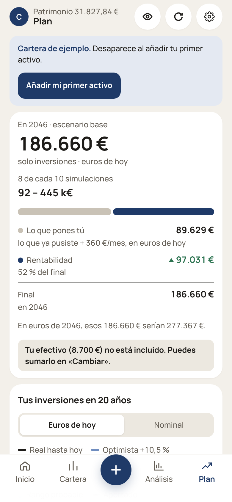
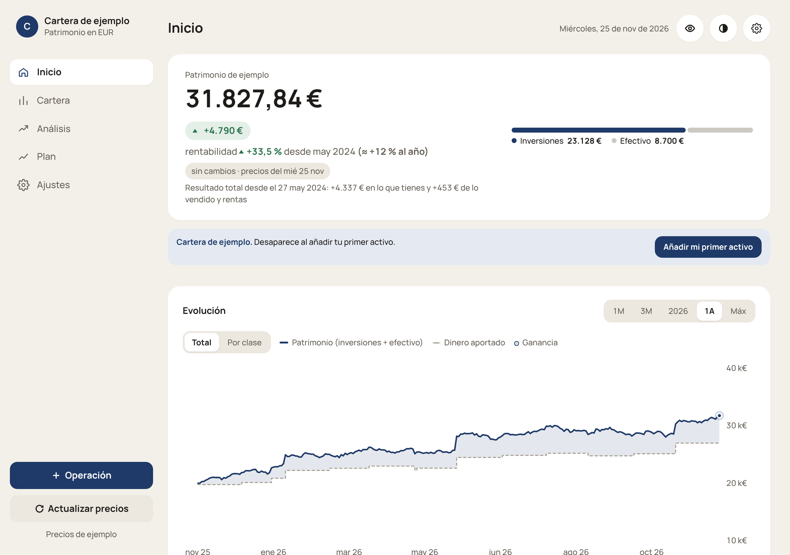
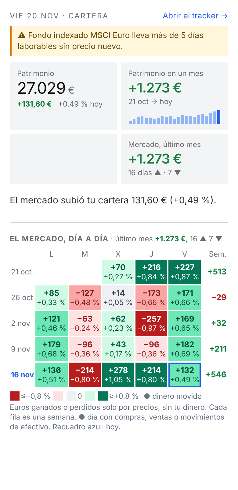

# Cartera · tracker de patrimonio e inversiones

Una app de una sola página para seguir tu patrimonio: fondos indexados, ETF, acciones, cripto y cuentas de efectivo, todo en euros. Calcula la rentabilidad real (TIR y TWR), los impuestos según las reglas españolas (FIFO y regla de los dos meses) y la evolución frente a un índice. También proyecta tu patrimonio a 20 años.

Está pensada para publicarse como **Artifact de claude.ai**: es un único HTML autocontenido. Los datos se guardan en la base de datos del propio Artifact y los precios se actualizan con una rutina de Claude en la nube. Sin esa base de datos, la app arranca en **modo demostración** con una cartera de ejemplo, así que puedes abrir `app.html` en cualquier navegador y verla funcionar.

> Todas las cifras de este repositorio y de las capturas son **de ejemplo**: salen de la cartera de demostración simulada (`src/js/app/core/demo.js`) y no corresponden a ninguna persona.

| Inicio | Cartera | Análisis | Plan |
|---|---|---|---|
|  |  |  |  |



## Qué hace

La app se organiza en cuatro secciones, cada una responde a una pregunta. Los ajustes van aparte.

**Inicio: ¿cómo voy?**
- Patrimonio total (inversiones + efectivo), cambio del día y rentabilidad desde el inicio, con la anual equivalente.
- «Esta semana»: qué ha movido la cartera, caídas relevantes y una estimación del día para los fondos cuyo valor liquidativo aún no ha llegado.
- «Para revisar»: como mucho tres avisos (precios antiguos, datos que no cuadran, restos pequeños de posiciones…).
- Gráfico de evolución: patrimonio frente a dinero aportado con la banda de ganancia, o el reparto por clase de activo.

**Cartera: ¿qué tengo?**
- Posiciones con valor, ganancia y mini gráfico, más una ficha por activo con su histórico, sus operaciones y un simulador de venta que calcula el impacto fiscal.
- Cuentas de efectivo con sus movimientos (aportaciones, retiradas, intereses).
- Reparto por clase, por zona geográfica (barras o **mapa mundial**) y por fondo, con pesos objetivo.
- Una sola lista de movimientos, rebalanceo y la calculadora «Voy a aportar…», que reparte una aportación según los pesos objetivo.

**Análisis: ¿lo estoy haciendo bien?**
- Comparación con un índice de referencia en el mismo periodo (TWR, TIR, diferencia, captura en subidas y bajadas).
- Mes a mes, qué ha aportado cada fondo, rentabilidad por año y fondo.
- Riesgo y caídas: volatilidad, máxima caída, semanas de más del 3 %, y eficiencia rentabilidad/riesgo de la cartera.
- Impuestos: ganancias y pérdidas por año fiscal con FIFO, pérdidas diferidas por recompra (art. 33.5 LIRPF) y tramos del ahorro.
- «Análisis de Claude»: observaciones generadas por Claude sobre tus propios datos (con la capacidad `sample` del Artifact).

**Plan: ¿a dónde voy?**
- Proyección a 20 años con supuestos editables por clase de activo, hitos y tabla año a año.
- Aportaciones periódicas, objetivo de ahorro y colchón de emergencia.
- «Mi analista»: un cuestionario de perfil de riesgo (1 a 5), un diagnóstico con reglas y un veredicto de Claude. Incluye un panel de contexto de mercado (BCE, Letras, caída del índice, CAPE, IPC) que solo muestra hechos con fecha y fuente, nunca previsiones.

**Ajustes**
- Alta y edición de activos: fondos por ISIN, ETF y acciones con símbolo, cripto, o precio manual.
- Importación de CSV propio o de DeGiro, conciliación con extractos de MyInvestor, y exportación.
- Datos a salvo: papelera de 90 días con «Deshacer», copias automáticas diarias y mensuales en la base de datos, y copia manual.
- Tema claro/oscuro, modo privacidad (oculta importes) y lo que pagas en comisiones de gestión (TER).

También funciona bien en el móvil, con una barra inferior y hojas deslizantes para los formularios, y se maneja con teclado.

## Probarla en un minuto

```bash
git clone https://github.com/leyva7/portfolio-tracker.git
cd portfolio-tracker
open app.html        # o xdg-open / doble clic: arranca en modo demostración
```

`app.html` ya viene construido. Solo necesita conexión para cargar Chart.js y la fuente Manrope desde un CDN.

## Construir

La app se edita en `src/` y se construye con un script sin dependencias (Node 18 o superior):

```bash
node build.js              # → app.html
node build.js otro.html    # → otro destino
```

`build.js` concatena los ficheros de `src/` en el orden de su lista `PARTS`. Si hay algún fichero en `src/` que no está en la lista, el build falla, para que nada se quede fuera sin darte cuenta.

## Pruebas

```bash
npm i -D playwright && npx playwright install chromium   # solo la primera vez
tests/run-all.sh
```

- `tests/engine.test.js`: el motor de cálculo con una cartera sintética cuyas cifras se comprueban a mano (FIFO, divisa, ganancias, XIRR).
- `tests/smoke.js`: abre la app en escritorio (1280 px) y móvil (390 px), en modo demostración y con una base de datos simulada, y recorre todas las secciones sin errores de JavaScript.
- `tools/demo-seed.js` genera `fixtures/demo-seed.json` a partir de la cartera de demostración, para el arnés.
- `tools/capturas.js` regenera las capturas de `docs/capturas/`.

## Publicarla como Artifact

1. `node build.js` y `tests/run-all.sh`.
2. Publica `app.html` como Artifact de claude.ai con las capacidades `db` (obligatoria para guardar datos), `sample` (análisis de Claude), `mcp` (para lanzar la rutina de precios con *Claude Code Remote*) y `downloads` (exportar).
3. Crea la rutina de precios (ver [docs/rutinas.md](docs/rutinas.md)) y pon su id en `NAV_TASK` (`src/js/app/core/prices.js`) o en el documento `settings/main` como `navTask`.
4. Opcional: escribe tu nombre en `settings/main.nombre` para que la cabecera diga «Hola, <nombre>».

## Estructura

```
app.html             la app construida (un único fichero)
build.js             construye app.html a partir de src/
src/
  head.html, body.html, tail.html   cabecera, marcado y cierre
  styles/                           CSS por bloques (base, componentes, móvil, tema «Calma», animaciones…)
  js/engine.js                      motor de cálculo: funciones puras, sin DOM
  js/motion.js                      ayudas de animación
  js/app/                           la app, por áreas (core, ui, tabs, modals, import, data)
harness/             arnés de Playwright con una base de datos simulada (mock de window.claude)
tests/               pruebas del motor y de la interfaz
tools/               datos de ejemplo y capturas
rutinas/             scripts y plantillas de las rutinas de Claude (precios, correos diario y semanal)
docs/                arquitectura, rutinas y capturas
```

Más detalle en [docs/arquitectura.md](docs/arquitectura.md).

## Rutinas en la nube

Tres tareas programadas de Claude Code completan la app:

- **Actualizar precios** (días laborables, 21:40 de Madrid): busca el valor liquidativo de cada fondo por ISIN, las cotizaciones de ETF, acciones y cripto y el cambio del dólar, y los guarda en la base de datos.
- **Resumen diario** (días laborables, 22:45): un correo con el patrimonio, el día del mercado en tu cartera, un calendario del mes y titulares de al menos dos fuentes.
- **Resumen semanal** (domingos): un correo más completo, con tres ideas de mejora y una copia de seguridad.

| Correo diario | Correo semanal |
|---|---|
|  |  |

Los correos los generan scripts de Python sin dependencias (`rutinas/correo/`) a partir de la base de datos, con cifras exactas. Claude solo lee los datos, ejecuta los scripts y envía el resultado. Todo está en [docs/rutinas.md](docs/rutinas.md).

## Decisiones de diseño

- **Euros como base.** Los activos en dólares se convierten con el cambio de cada día.
- **FIFO** para el coste y las ganancias, como exige el IRPF. Los traspasos entre fondos conservan el coste y la antigüedad de los lotes.
- **El efectivo suma al patrimonio pero no entra en TWR ni TIR**, para que la rentabilidad mida solo las inversiones.
- **No se inventan datos.** Un precio sin fecha no se guarda, una cifra que falta no se muestra, y la estimación del día se etiqueta siempre como estimación.
- **Sin recomendaciones de inversión.** El análisis describe y compara, no dice qué comprar ni cuándo.

## Licencia

[MIT](LICENSE). Incluye [Chart.js](https://www.chartjs.org/) 4.4.1 (MIT) en `harness/` para las pruebas sin red. El mapa usa geometría de [Natural Earth](https://www.naturalearthdata.com/), que es de dominio público.

Esto es un proyecto personal, no asesoramiento financiero.
