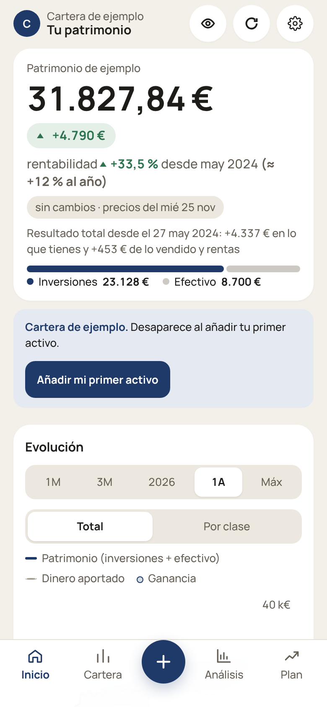
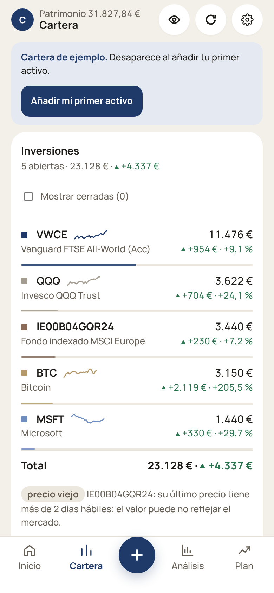
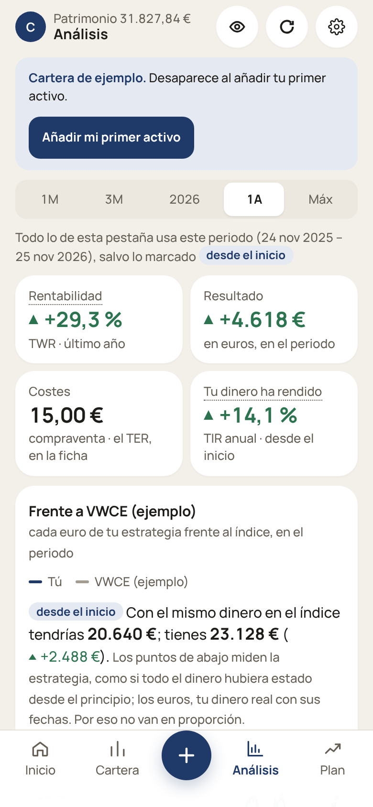
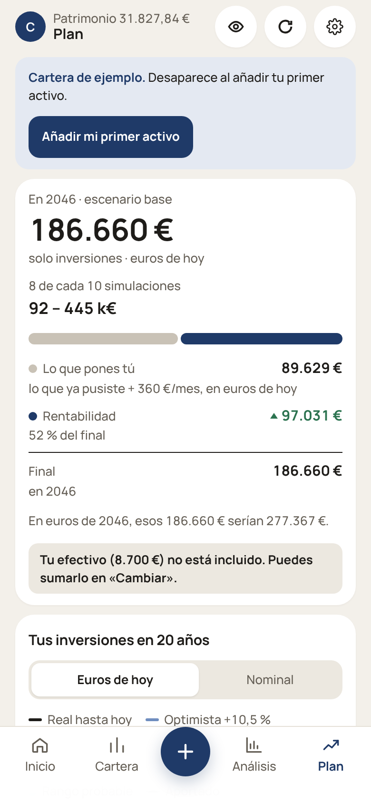
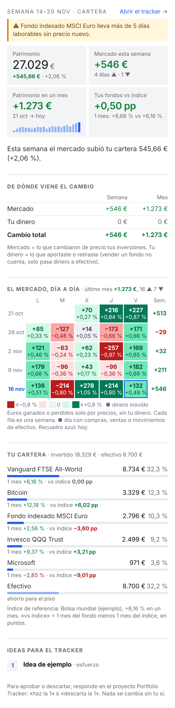

# Cartera · net worth and investment tracker

A single-page app for tracking your net worth across index funds, ETFs, stocks, crypto and cash accounts, all in euros. It computes real returns (money-weighted IRR and time-weighted TWR) and Spanish capital-gains tax (FIFO plus the two-month wash-sale rule). It also compares your portfolio against a benchmark index and projects your net worth 20 years ahead.

It is built to be published as a **claude.ai Artifact**: one self-contained HTML file. Data lives in the Artifact's own database, and prices are refreshed by a scheduled Claude routine in the cloud. Without that database the app starts in **demo mode** with a sample portfolio, so you can open `app.html` in any browser and see it working.

> The user interface is in Spanish (es-ES). Every figure in this repository and its screenshots is **sample data** from the simulated demo portfolio (`src/js/app/core/demo.js`), not anyone's real portfolio.

| Home | Portfolio | Analysis | Plan |
|---|---|---|---|
|  |  |  |  |


## Features

The app has four sections, each answering one question, plus a settings area.

**Home (Inicio): how am I doing?**
- Total net worth (investments + cash), today's change, and the return since inception with its annualized equivalent.
- "This week": what moved the portfolio, notable drops, and an intraday estimate for funds whose NAV hasn't been published yet.
- "To review": at most three alerts, such as stale prices, data that doesn't reconcile, or tiny leftover positions.
- Evolution chart: net worth against money contributed, with the gain band, or a breakdown by asset class.

**Portfolio (Cartera): what do I own?**
- Positions with value, gain and a sparkline. Each asset has a detail sheet with its history, its trades and a sale simulator that shows the tax impact.
- Cash accounts and their movements (deposits, withdrawals, interest).
- Allocation by asset class, by region (bars or a **world map**) and by fund, against target weights.
- One combined list of transactions, a rebalancing view and an "I'm going to invest…" calculator that splits a contribution by target weights without selling.

**Analysis (Análisis): am I doing it right?**
- Comparison with a benchmark over the same period: TWR, IRR, difference, and upside/downside capture.
- Month by month, each fund's contribution since inception, and returns by year and fund.
- Risk and drawdowns: volatility, maximum drawdown, weeks down more than 3 %, and a risk/return efficiency view of the portfolio.
- Taxes: gains and losses by tax year using FIFO, losses deferred by repurchase (Spanish income tax law, art. 33.5 LIRPF), and the savings-income tax brackets.
- "Claude's analysis": observations Claude generates from your own data, through the Artifact's `sample` capability.

**Plan: where am I heading?**
- A 20-year projection with editable assumptions per asset class, milestones and a year-by-year table.
- Recurring contributions, a savings goal and an emergency fund.
- "My analyst" (Mi analista): a risk-profile questionnaire (1 to 5), a rule-based diagnosis and a verdict from Claude. It includes a market-context panel (ECB rate, Spanish T-bills, index drawdown, CAPE, inflation) that shows only dated, sourced facts, never forecasts.

**Settings (Ajustes)**
- Add and edit assets: funds by ISIN, ETFs and stocks by symbol, crypto, or manual prices.
- Import your own CSV or a DeGiro export, reconcile with MyInvestor statements, and export everything.
- Data safety: a 90-day trash with "Undo", automatic daily and monthly backups inside the database, and manual backups.
- Light/dark theme, a privacy mode that hides amounts, and what you pay in fund fees (TER).

It works well on mobile, with a bottom navigation bar and slide-up sheets for forms, and it is fully keyboard accessible.

## Try it in a minute

```bash
git clone https://github.com/leyva7/portfolio-tracker.git
cd portfolio-tracker
open app.html        # or xdg-open / double-click: it starts in demo mode
```

`app.html` is already built. It only needs a connection to load Chart.js and the Manrope font from a CDN.

## Build

You edit the app in `src/` and build it with a dependency-free script (Node 18 or later):

```bash
node build.js              # → app.html
node build.js other.html   # → another output path
```

`build.js` concatenates the files in `src/` in the order of its `PARTS` list. If a file in `src/` is missing from that list, the build fails, so nothing gets left out silently.

## Tests

```bash
npm i -D playwright && npx playwright install chromium   # first time only
tests/run-all.sh
```

- `tests/engine.test.js` checks the calculation engine against a synthetic portfolio whose figures were worked out by hand (FIFO, currency conversion, realized gains, XIRR).
- `tests/smoke.js` opens the app at desktop (1280 px) and mobile (390 px) widths, both in demo mode and against a mocked database, and visits every section with no JavaScript errors.
- `tools/demo-seed.js` generates `fixtures/demo-seed.json` from the demo portfolio for the test harness.
- `tools/capturas.js` regenerates the screenshots in `docs/screenshots/`.

## Publishing it as an Artifact

1. Run `node build.js` and `tests/run-all.sh`.
2. Publish `app.html` as a claude.ai Artifact with these capabilities: `db` (required to save data), `sample` (Claude's analysis), `mcp` (to start the price routine through *Claude Code Remote*) and `downloads` (export).
3. Create the price routine (see [docs/routines.md](docs/routines.md)). Put its id in `NAV_TASK` (`src/js/app/core/prices.js`) or as `navTask` in the `settings/main` document.
4. Optional: set your name in `settings/main.nombre` so the header greets you by name.

## Layout

```
app.html             the built app (one file)
build.js             builds app.html from src/
src/
  head.html, body.html, tail.html   page head, markup and closing tags
  styles/                           CSS by area (base, components, mobile, "Calma" theme, motion…)
  js/engine.js                      calculation engine: pure functions, no DOM
  js/motion.js                      animation helpers
  js/app/                           the app, by area (core, ui, tabs, modals, import, data)
harness/             Playwright harness with a mocked database (window.claude mock)
tests/               engine and UI tests
tools/               demo data and screenshots
rutinas/             scripts and prompt templates for the Claude routines (prices, daily and weekly emails)
docs/                architecture, routines and screenshots
```

More detail in [docs/architecture.md](docs/architecture.md).

## Cloud routines

Three scheduled Claude Code tasks complete the app:

- **Update prices** (weekdays, 21:40 Madrid time): fetches each fund's NAV by ISIN, quotes for ETFs, stocks and crypto, and the USD/EUR rate, and saves them to the database.
- **Daily summary** (weekdays, 22:45): an email with your net worth, what the market did to your portfolio today, a monthly calendar and headlines from at least two sources.
- **Weekly summary** (Sundays): a fuller email with three improvement ideas and a backup.

| Daily email | Weekly email |
|---|---|
|  |  |

The emails are generated by dependency-free Python scripts (`rutinas/correo/`) straight from the database, with exact figures. Claude only reads the data, runs the scripts and sends the result. See [docs/routines.md](docs/routines.md).

## Design decisions

- **Euro base.** USD assets are converted at each day's rate.
- **FIFO** for cost basis and gains, as Spanish income tax requires. Fund-to-fund transfers keep the lots' cost and dates.
- **Cash counts toward net worth but not toward TWR or IRR**, so returns measure investments only.
- **Nothing is made up.** A price without a date is not saved, a missing figure is not shown, and the intraday estimate is always labelled as an estimate.
- **No investment advice.** The analysis describes and compares; it never says what to buy or when.

## License

[MIT](LICENSE). Bundles [Chart.js](https://www.chartjs.org/) 4.4.1 (MIT) in `harness/` for offline tests. The world map uses [Natural Earth](https://www.naturalearthdata.com/) geometry (public domain).

This is a personal project, not financial advice.
